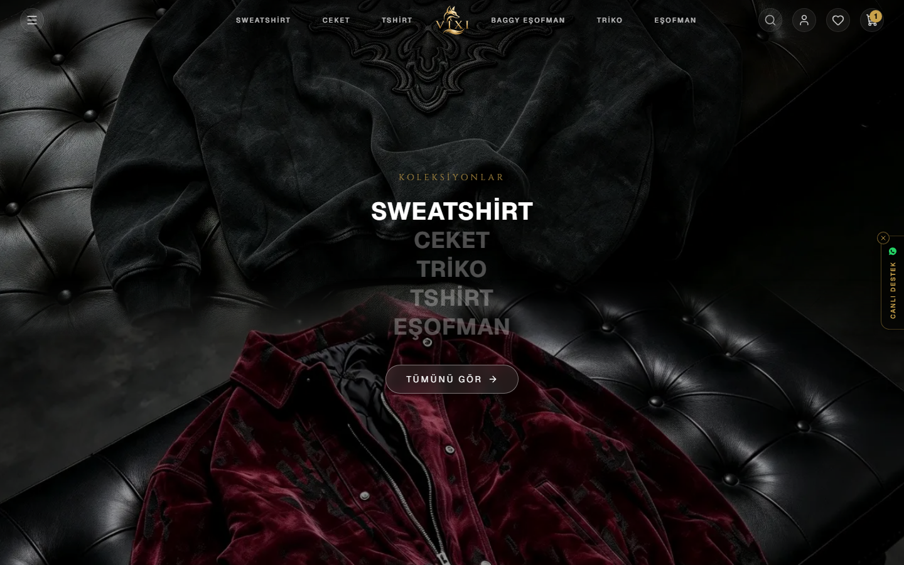
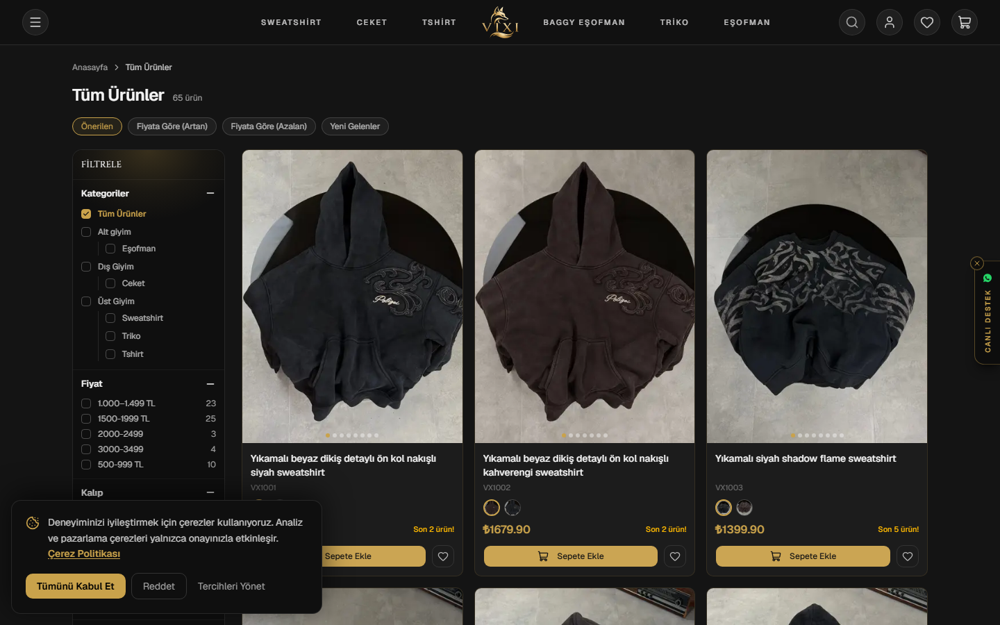
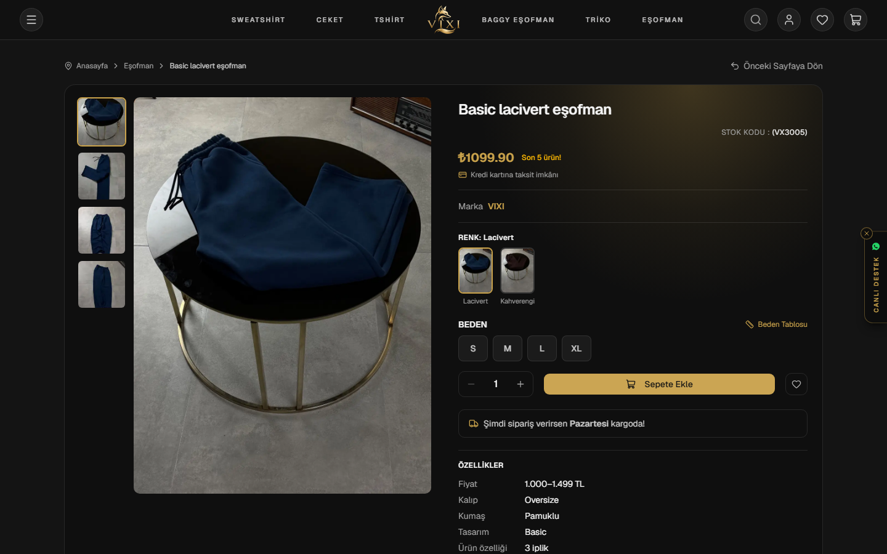
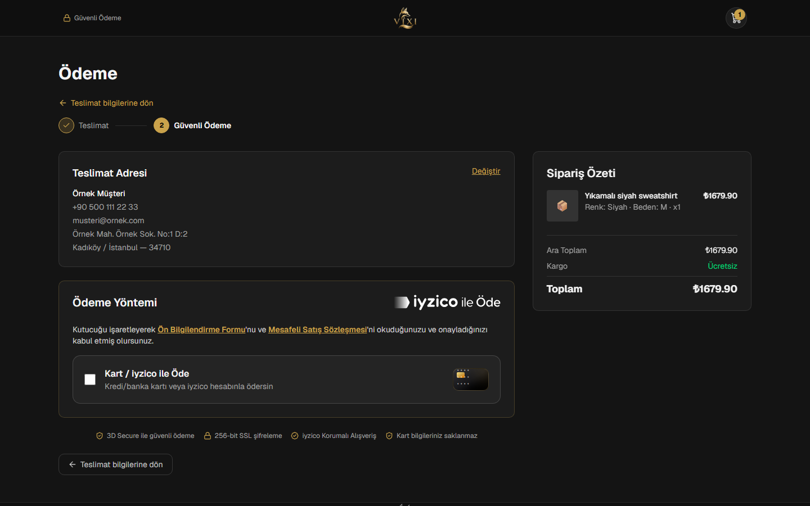
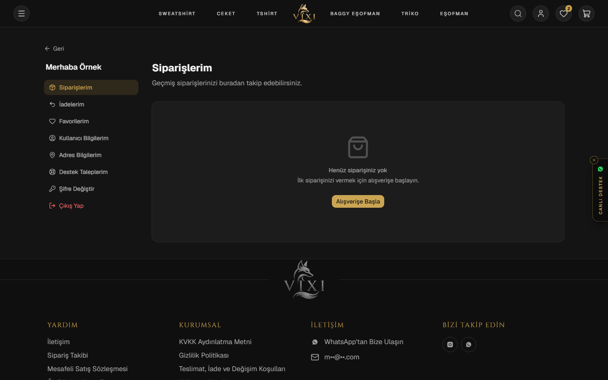
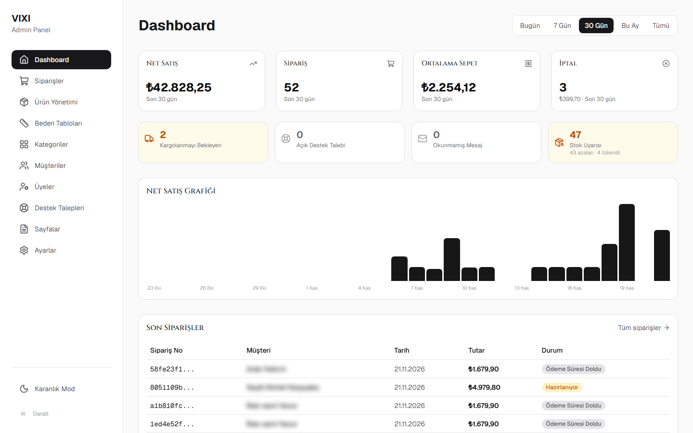
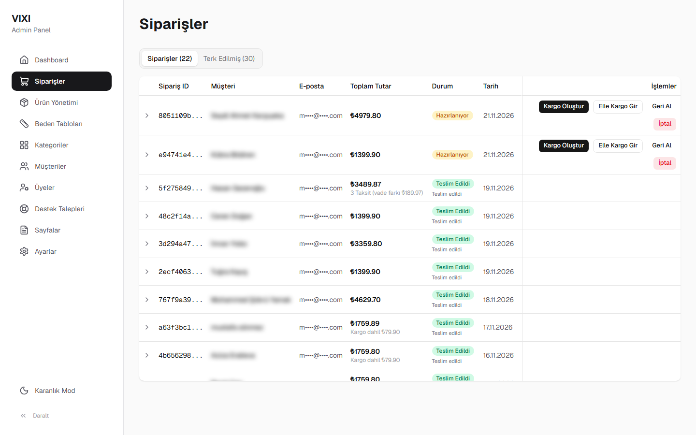
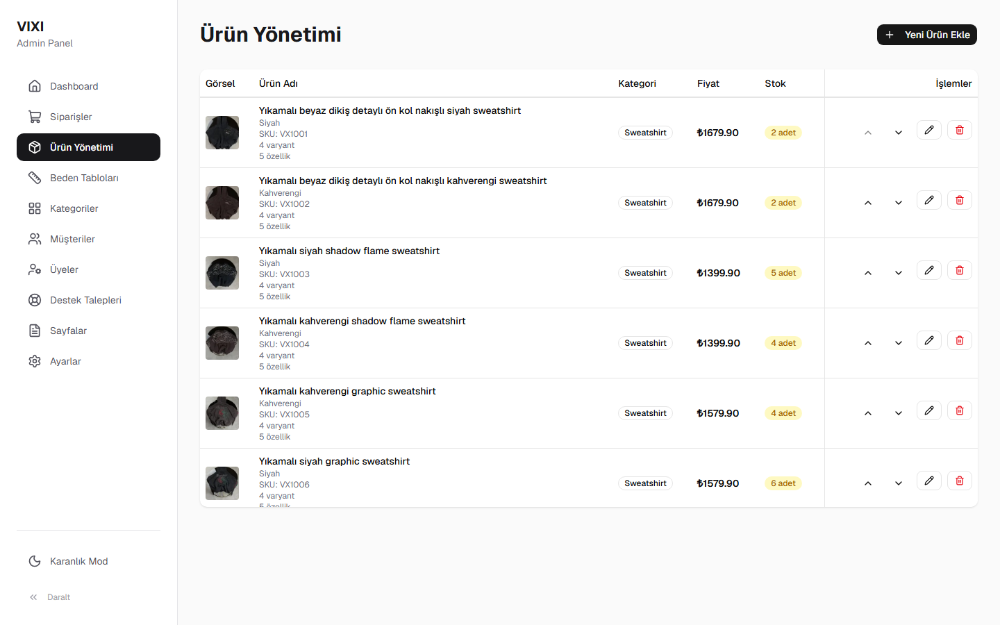
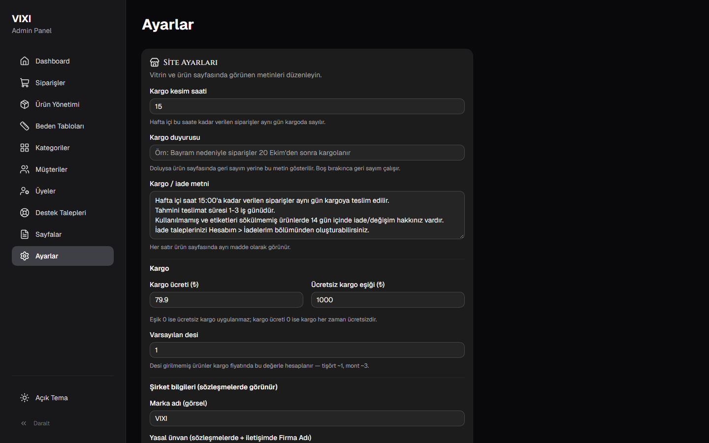

# VIXI — Production E-Commerce Platform (Case Study)

End-to-end custom e-commerce platform built for **[vixiwear.com](https://vixiwear.com)**, a Turkish fashion brand. Live in production — processing real orders, payments, shipments, invoices and returns.

> **Built by Ercan Çelik** — full-stack design, build, integrations and launch.
> [Portfolio](https://ercancelikbusiness.github.io) · [LinkedIn](https://www.linkedin.com/in/ercan-çelik-7b13a9324) · ercancelikbusiness@gmail.com

## Stack

**Next.js 16** (App Router · TypeScript · Turbopack) · **React 19** · **Tailwind v4** · **Supabase** (Postgres + Auth + Storage + Realtime + RLS) · **Zustand** · **Vercel** (hosting + crons) · **Sentry**

## Feature map

| Area | What was built |
|---|---|
| **Storefront** | Dark-theme responsive UI · hero video/slider with mobile-specific sources · category groups · facet filtering + price sort · live search suggestions · color-sibling products via `model_code` · per-variant stock · size charts + "Find My Size" wizard · WhatsApp live support |
| **Checkout** | 2-step flow · server-side price authority (client prices ignored) · sale prices · shipping fee + free-shipping threshold · billing/corporate invoice fields (TC, tax office, tax no) · contract acceptance logged with IP + timestamp · draft recovery |
| **Payments — İyzico** | CheckoutForm integration (3D Secure · installments · iyzico wallet · card saving) · **custom IYZWSv2 HMAC signing — no SDK** · callback signature verification · amount cross-check · fraud-status gate · idempotent/atomic PENDING→PAID transition · pending-order expiry cron |
| **Accounts** | Phone-OTP (Netgsm) + email/password on a single identity · address book · favorites · order history · returns portal · support tickets · marketing consent |
| **Order lifecycle** | `PENDING→PAID→PROCESSING→SHIPPED→DELIVERED` (+CANCELLED/FAILED/EXPIRED) · self-service cancel before processing · partial refunds via iyzico item transactions · stock restore on cancel |
| **Shipping** | Carrier-agnostic via BasitKargo & KargoJet aggregators (Yurtiçi, MNG, Aras, Hepsijet…) — quote→barcode→printable label→webhook→delivery emails · return-cargo codes · polling cron fallback · shipment event timeline |
| **Invoicing** | **BirFatura** e-Archive/e-Invoice auto-issued on shipment + PDF email · taxpayer registry lookup · gider pusulası (withholding slip) reminders |
| **Admin** | Dashboard · orders/products/categories/customers/members/support/CMS pages/size charts/site settings · dark mode · realtime order feed · Telegram new-order + ops alerts + daily health report (SMS balance, pending shipments/invoices/refunds/tickets) |
| **Compliance** | KVKK cookie consent (analytics/marketing separately gated) · legal pages CMS · ETBİS registration · Turnstile bot protection · IP rate limiting · RLS everywhere |
| **Marketing** | GA4 + Meta Pixel + Meta CAPI + Microsoft Clarity (all consent-gated) · Google Merchant feed · Google Customer Reviews · product JSON-LD · dynamic sitemap/robots |

| | |
|---|---|
|  |  |
|  |  |
|  |  |

**Admin panel** (customer PII blurred):

| | |
|---|---|
|  |  |
|  |  |

## Architecture highlights

- **No SDK for the payment processor** — IYZWSv2 auth = `HMACSHA256(randomKey + uri + body, secret)` implemented by hand; callback detail signatures verified before touching order state.
- **Idempotency by design** — PAID transition is a single atomic `UPDATE … WHERE order_status='PENDING'`; repeated/late callbacks can't double-decrement stock or re-send notifications. PENDING orders expire on a cron (45 min) and recover to PAID if payment lands late.
- **Provider-agnostic shipping** — KargoJet and BasitKargo adapters funnel into one `applyShipmentUpdate` pipeline; webhooks are HMAC-verified and deduplicated, with a polling cron as fallback.
- **Invoice timing = shipment** — e-Archive/e-Invoice issues when an order ships (VUK 7-day compliant, no wasted quota on pre-shipment cancels); iyzico `cancel` same-day → `refund` next-day → manual fallback.
- **Consent-gated analytics** — GA4/Meta/Clarity/CAPI scripts only mount after explicit opt-in; no trackers = no banner, KVKK-clean.
- **Security** — RLS on every table (default-deny), Turnstile on auth/SMS/contact, DB-backed IP rate limits, lazy secret init (missing env never breaks builds), server-side verification of every client-supplied value.

## Hard problems solved along the way

- iyzico callback `conversationId` ≠ init value → matched on `basketId`; partial refunds keyed via `itemTransactions` → `payment_transaction_id`.
- Cargo provider returned `COMPLETED` instead of documented `DELIVERED` → status mapping + alerting corrected against live payloads.
- Netgsm OTP endpoint rejects Turkish characters → ASCII normalization + channel fallback; header approval requires BTK-compliant sender names.
- Supabase egress + Vercel image-optimization quota crises → client-side image compression, 31-day cache TTLs, bounded hero video.

## Source code

The production repository is private (it powers a live business). This repo documents the architecture, decisions and outcomes.
